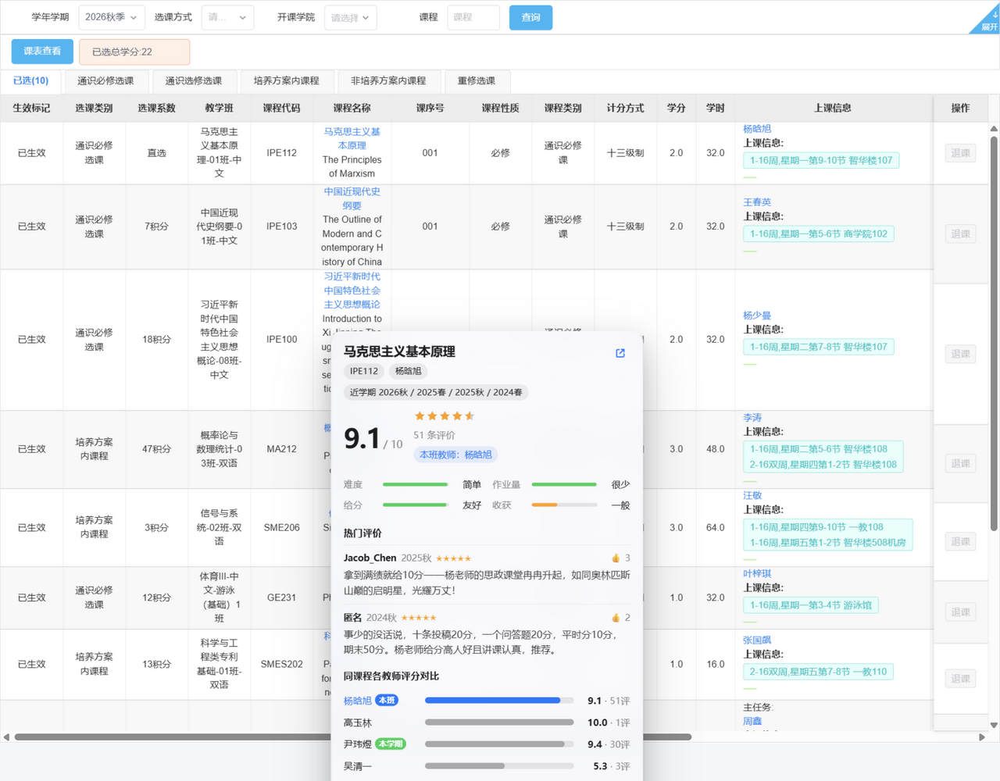
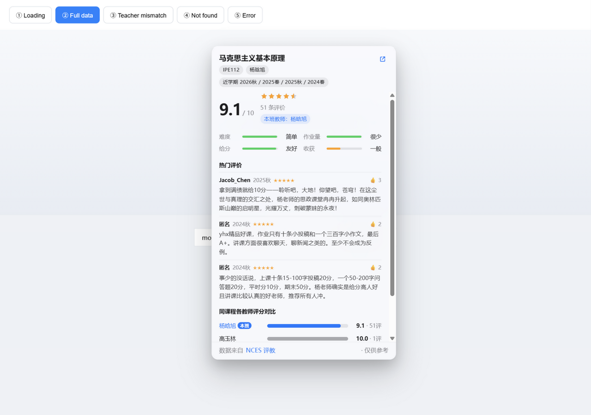
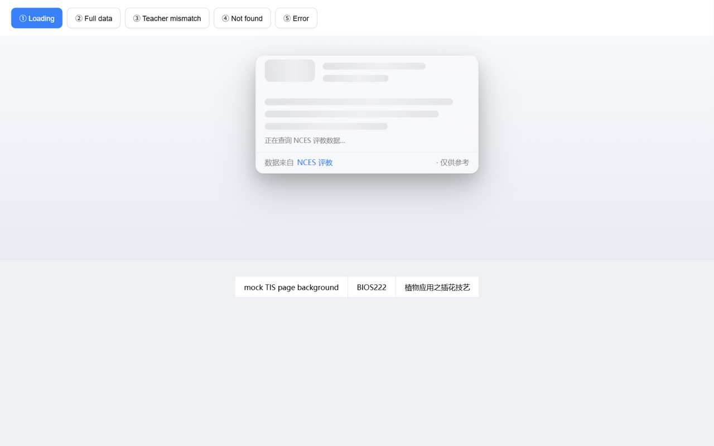
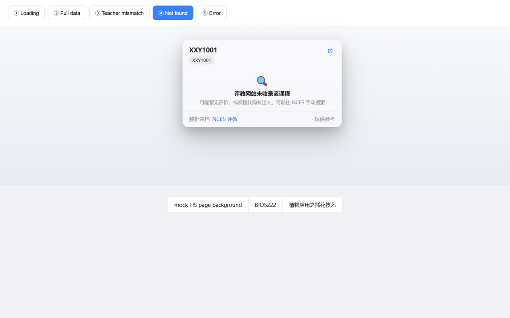
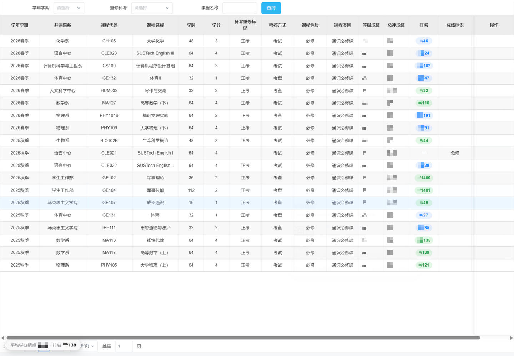
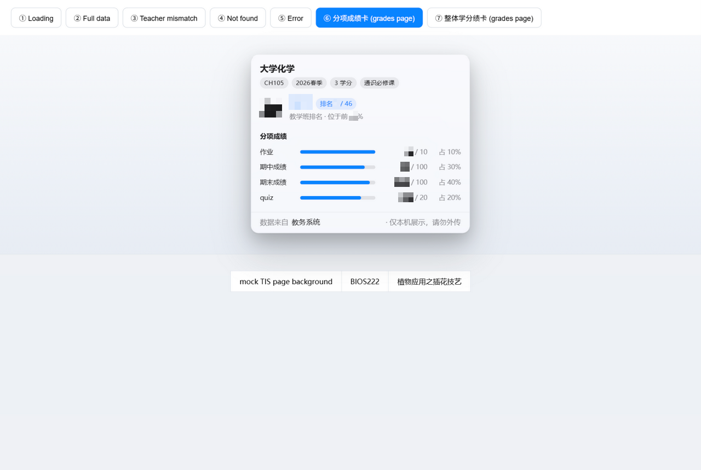
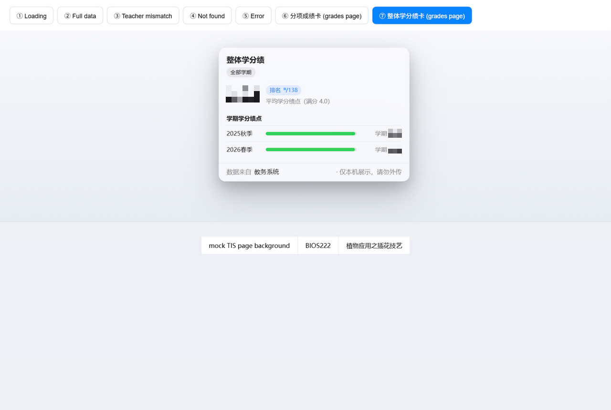

> # ⭐ Acknowledgements
>
> This project stands on the shoulders of two giants — credited first, at the very top:
>
> - 📊 **Data source: [NCES (ncesnext.com)](https://ncesnext.com/)** — a community-built, unofficial course-review website maintained by SUSTech students. **All** ratings, review texts and per-teacher comparison data shown by this extension come live from that site. Please visit the site and leave your own reviews to keep the dataset alive.
> - 🧰 **[dumixthestpd/sustech_survival](https://github.com/dumixthestpd/sustech_survival)** — every detail of how this extension talks to the NCES JSON API (endpoint contract, teacher-team matching algorithm, rate limiting and 429 back-off) was learned from the `src/sustech_survival/nces/` module of that project. Huge thanks — it made a fast, correct implementation possible.
>
> *This project is not affiliated with Southern University of Science and Technology (SUSTech) or NCES. For learning and personal use only.*

<div align="center">

# SUSTech Course Rating Assistant (TIS × NCES)

**Hover any course row on the course-selection page to see NCES ratings and teacher comparisons; on the grades page, see per-course ranks, hover for sub-scores, and track your overall GPA/rank live.**



</div>

## What it is

SUSTech's TIS (teaching information system) shows no course-review data during course selection, forcing students to switch between tabs constantly. This browser extension (Chrome / Edge, Manifest V3) adds a "hover to inspect" ability to every course row on the **Course Selection (我要选课)** and **Extra-enrollment Application (加课申请)** pages:

| Feature | Details |
| --- | --- |
| ① Rating | Big 0–10 score + 5-star strip + review count + covered semesters |
| ② Brief reviews | Top-liked reviews (author, semester, stars, upvotes), up to 3 |
| ③ Teacher comparison | Horizontal bar chart of **all** sections of the same course code: current section highlighted & pinned on top, current semester flagged green; click a row to open its NCES page |
| 4-dimension profile | Difficulty / workload / grading / takeaways on a 0–100 scale |
| Anti-misattribution | Yellow warning when the TIS teacher team doesn't match NCES data — never shows another section's score as "yours" |

| Full card | Loading skeleton | Not found |
| --- | --- | --- |
|  |  |  |

## Grades page features (new in v1.1)

Works automatically on the **Grades → Personal Grade Query** page:

| Feature | Details |
| --- | --- |
| **Rank column** | Injects a "rank/total students" column per course (e.g. `12/60`), top 10% of the class highlighted green. The backend has always returned this data — the official frontend simply never rendered it |
| **Hover for sub-scores** | Hover any course row to see the overall score, grade letter, rank (with percentile) plus per-item scores (homework/midterm/final/quiz) and their weights |
| **GPA pill** | A floating pill in the bottom-left shows your average GPA and rank live (e.g. `3.85 · 12/120`); hover it for the per-semester breakdown |



| Sub-score card on hover | Overall GPA breakdown |
| --- | --- |
|  |  |

> **Fun finding**: the official "GPA rank query" page calls `POST /cjgl/xscjgl/xsgrcjcx/queryXnAndXqXfj`, but the framework injects a `RoleCode` request header whose value is null, so the backend returns empty JSON (the page shows "no data"). Simply omitting that header returns the real data — this may be one reason the school's page appears to have no rank, and is worth reporting upstream.

## Install

1. Download this repository (`Code → Download ZIP`, then extract).
2. Open `edge://extensions` (Edge) or `chrome://extensions` (Chrome).
3. Enable **Developer mode** (top corner).
4. Click **Load unpacked** and pick the extracted `sustech-nces-helper` folder.
5. Refresh the TIS course-selection page. **No NCES login required.**

> If the browser shows a "disable developer mode extensions" prompt on startup, just dismiss it.

## Usage

- Open Course Selection (or Extra-enrollment Application), run a query, then **hover any course row**:
  a skeleton card appears after ~0.15 s, real data fills in 1–3 s; hovering the same course again is **instant** (6-hour local cache).
- On the Grades page (Grades → Personal Grade Query): a Rank column appears automatically; **hover any course row** for sub-scores; the bottom-left pill shows your overall GPA/rank and expands on hover.
- Clicking the row's empty area also opens the card; `Esc`, page scroll or clicking elsewhere closes it.
- Text inside the card is selectable; clicking a comparison row opens that section's NCES page in a new tab.

## How it works

```
content.js (injected per iframe)
│  Delegated listeners on tr.ivu-table-row — bound once,
│  immune to iView table re-renders (query / pagination / tab switch)
│  Columns aligned by header text ("课程代码" / "上课信息" …),
│  extracting course code + teacher names (<a> links) + semester
│
├─ chrome.runtime.sendMessage ──────────────► background.js (MV3 service worker)
│                                              │  chrome.storage cache: hit 6h / miss 15min
│                                              │  250 ms serialized rate limit + 429 exponential back-off
│                                              ▼
│                                          nces-core.js (pure logic, testable in Node)
│                                              │  GET ncesnext.com/api/v1/search?q=<course code>
│                                              │  GET /api/v1/search?q=<teacher>  (find sections beyond top-5)
│                                              │  GET /api/v1/course/<id>/reviews (all reviews → top-liked 3)
│                                              │  Section pick: teacher overlap → full team → current term → review count
│                                              ▼
└─ card.js ◄────────────────────────────────  brief: rating / dims / reviews / all sections
   Shadow-DOM frosted-glass card (Apple-style),
   dark mode / reduced motion / reduced transparency, textContent-only (XSS-safe)

grade.js (grades page, /cjgl/grcjcx/go/*, same card component)
│  POST /cjgl/grcjcx/grcjcx          → pm/zrs per course → inject "rank" column
│  POST /cjgl/grcjcx/seeFx           → hover a row → per-item score card
│  POST /cjgl/xscjgl/xsgrcjcx/queryXnAndXqXfj → bottom-left GPA/rank pill
│  Row alignment by "term+course code+final score" content match
│  (immune to filtering/sorting/pagination); MutationObserver re-injects
```

Key design decisions:

- **Interaction choice** — three options were weighed: ① hover popover, ② row click, ③ per-row button. Row click collides with native interactions (course-detail links, enroll/cart buttons); per-row buttons need a MutationObserver fighting iView's frequent re-renders. A delegated hover listener is bound once and survives any re-render — option ① wins, with "click row's empty area" as a fallback.
- **Perceived latency** — one NCES search takes ~1.3 s; a full brief needs 2–4 serialized calls. The skeleton card appears immediately, data fills in 1–3 s; a two-layer cache (memory + `chrome.storage.local`) makes repeat hovers 0 ms.
- **Column mapping** — every iView column carries a random class `ivu-table-column-XXXX`, shared between header and cells. Mapping "header text → token → cell" is robust to column order, fixed and hidden columns. The mapping must never be cached — iView regenerates tokens when it rebuilds the header (a pit we hit).
- **The rank column isn't scraped** — the grades API has always returned `pm` (rank) and `zrs` (class size); the official table just doesn't render them. The extension aligns DOM rows with API records by content (immune to filtering/sorting/pagination) and stashes each record on its row for hover use.
- **Hover-state self-healing** — when a card is dismissed by scroll / Esc / window blur, the pointer may never truly leave the shadow host, freezing the "pointer inside card" flag and killing every later hover. Fixed with a `host.matches(':hover')` reality check plus "same row but card gone → reschedule" (a real bug we fixed).
- **Never misattribute** — following sustech_survival's discipline: a section counts as "the same class" only if **every** TIS teacher appears in its NCES teacher list; otherwise a yellow warning shows instead of wrong numbers.
- **Term mapping** — page label "2026秋季" → TIS `xn=2026-2027, xq=1` → NCES `term_id=20261`; spring/summer terms belong to the previous academic year.

## Directory structure

```
sustech-nces-helper/
├── manifest.json      # MV3 manifest (content_scripts on tis.sustech.edu.cn, all_frames)
├── background.js      # service worker: message routing / cache / rate limit
├── nces-core.js       # NCES data core (pure logic, directly testable in Node)
├── content.js         # Course-selection pages: row parsing / hover / card lifecycle
├── grade.js           # Grades page: rank column / sub-score card / GPA pill
├── card.js            # Hover card (Shadow DOM, Apple-style, dark mode & reduced motion)
├── icons/             # Extension icons
├── tools/             # Icon generator & local demo server (not shipped at runtime)
└── DEMO/              # Visual-acceptance mock page (not shipped at runtime)
```

## Development

```bash
# Generate icons (zero-dependency, hand-written PNG encoder)
node tools/gen-icons.js

# Local demo page for the card UI (http://127.0.0.1:8811/)
node tools/serve-demo.js

# Exercise the NCES pipeline directly in Node (no extension needed)
node --input-type=module -e "import('./nces-core.js').then(async m => {
  const fetchJSON = async (u) => (await fetch(u)).json();
  console.log(await m.lookupBrief({ fetchJSON, cacheGet: async()=>null, cacheSet: async()=>{} },
    { code: 'IPE112', teachers: ['杨晗旭'], termLabel: '2026秋季' }));
})"
```

## Privacy

- No data collection, no analytics; review lookups carry no identity, and TIS cookies are never read or forwarded.
- Query results are cached locally only (`chrome.storage.local`).

## Disclaimer

Ratings and reviews come from the third-party, unofficial site [ncesnext.com](https://ncesnext.com/) and are for reference only. Use at your own risk.

## License

[MIT](LICENSE)
